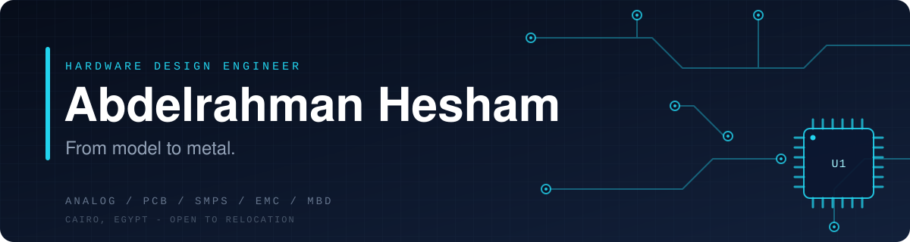
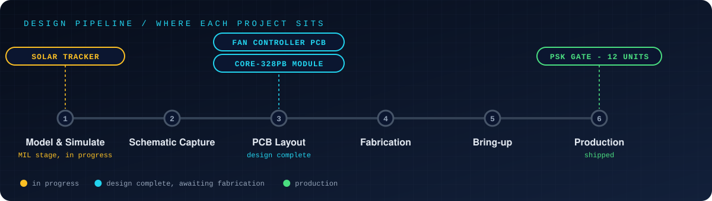
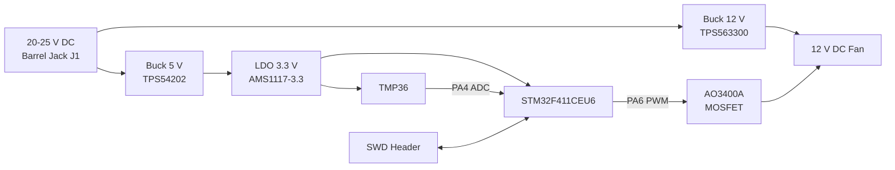
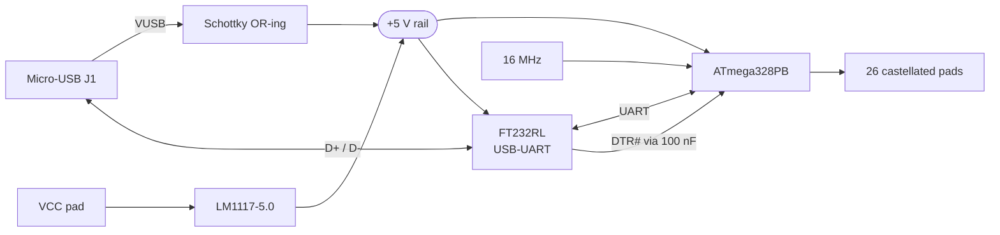
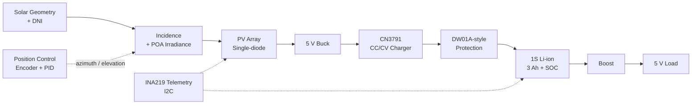

 

**[Datasheet](#-profile-datasheet)** · **[Pipeline](#-design-pipeline)** · **[Current Work](#-current-work)** · **[Shipped & Earlier](#-shipped--earlier-work)** · **[Capabilities](#-capability-matrix)** · **[Contact](#-contact)**

 

---

## 📄 Profile Datasheet

> Hardware design engineer focused on **analog circuit and PCB design**: schematic capture, PCB layout, SMPS, and EMC. I take embedded hardware from model, to schematic, to layout, to prototype, to production. My most complete project to date, the **PSK Gate System**, went from a working prototype to a **12-unit production run**.
>
> My background also covers embedded firmware (PIC, AVR, Tiva C) and **Model-Based Design** (MATLAB/Simulink) for control-loop and driver-circuit work. I am pursuing an M.Sc. in Mechatronics and Robotics Engineering at Ain Shams University, working toward a senior Hardware Design role.

| Parameter | Value |
|:--|:--|
| **Role** | Hardware Design Engineer |
| **Core focus** | Analog circuit design · PCB design for manufacturing · SMPS · EMC |
| **Design tools** | Altium Designer · AutoCAD Electrical · MATLAB / Simulink / Stateflow |
| **Silicon & platforms** | ATmega328PB · STM32F411 · PIC · Tiva C · FT232RL · TPS54202 / TPS563300 |
| **Production record** | PSK Gate System: prototype → **12-unit production run** |
| **Education** | M.Sc. Mechatronics & Robotics, Ain Shams *(in progress)* · B.Sc. Mechatronics, GPA **3.71 / 4.0** |
| **Location** | Cairo, Egypt · open to relocation |

---

## 🧭 Design Pipeline

Every project here sits somewhere on the same road, from a simulated idea to a shipped product. This is where each one stands today.

---

## 🔬 Current Work

Three recent designs, covering the full spectrum from **pure simulation** to **power-electronics hardware** to a **reusable MCU module**.

 

### ① Temperature-Controlled DC Fan PCB

**`STM32F411` · `Altium Designer` · `Multi-rail SMPS`** · [**View repository →**](https://github.com/ae-hesham/temperature-controlled-fan-pcb)

*A compact STM32-based controller that measures temperature and drives a 12 V DC fan with PWM, powered from a single 20-25 V DC input.*

| | |
|:--|:--|
| **Stage** |  Schematic and layout done · Gerber export, fabrication, firmware next |
| **Power tree** | 20-25 V DC → **12 V** buck (TPS563300) · **5 V** buck (TPS54202) → **3.3 V** LDO (AMS1117-3.3) |
| **Control** | STM32F411CEU6 (Cortex-M4F, 100 MHz) · TMP36 sensed on 12-bit ADC (`PA4`) · fan PWM on `PA6` |
| **Fan stage** | AO3400A low-side MOSFET · 150 Ω gate resistor · 10 kΩ pull-down keeps fan off during boot · SS14 flyback diode |
| **Robustness** | Ferrite-filtered `VREF+` · bulk capacitance on every rail · 4-pin SWD debug header |
| **Documentation** | Hierarchical schematic (4 functional sheets) · bring-up plan · design review |

<b>Architecture</b>

 

### ② CORE-328PB: Castellated Microcontroller Module

**`ATmega328PB` · `FT232RL` · `Altium Designer`** · [**View repository →**](https://github.com/ae-hesham/CORE-328PB)

*A solder-down, USB-serial programmable 8-bit AVR module with an on-board 5 V regulator, source-OR-ed power path, and 26 castellated I/O pads, built to be dropped onto a carrier board as an SMD component.*

| | |
|:--|:--|
| **Stage** |  Layout done · fabrication and bring-up next |
| **Core** | ATmega328PB (VFQFN-32) · 16 MHz crystal · 5 V logic |
| **Programming** | FT232RL USB-UART with **DTR-driven auto-reset** over micro-USB |
| **Power path** | `VCC` pad → LM1117-5.0 LDO · USB bus power via Schottky OR-ing · shared 5 V rail on `+5V` pad |
| **I/O** | 26 castellated pads: 14 digital · 8 analog · `AREF` · `+5V` · `VCC` · `GND` |
| **Engineering rigor** | Design-review findings documented · BOM with MPNs · structured bring-up checklist |

<b>Architecture</b>

 

### ③ Dual-Axis Solar Tracker: Model-Based Design Study

**`MATLAB / Simulink` · `Stateflow` · `Model-in-the-Loop`** · [**View repository →**](https://github.com/ae-hesham/Dual-Axis-Solar-Tracker-MBD-and-Hardware)

*A system-level Simulink model of a small dual-axis solar tracker with battery charging: 6 W PV panel, 1S Li-ion battery, 5 V load.*

| | |
|:--|:--|
| **Stage** |  Simulation-only study |
| **Constraint** | **Library-only Simulink**: no MATLAB Function blocks or scripts in the loop, so the model stays code-generator-ready |
| **Workflow** | **Verify, then integrate**: each subsystem is checked against analytical baselines before system integration |
| **Plant** | Solar geometry with cloud transients · POA irradiance · single-diode PV model (≈ **4.8 W** at solar noon) |
| **Power chain** | 5 V buck · CN3791 CC/CV charger · DW01A-style protection · 3 Ah Li-ion SOC estimator · boost output stage |
| **Control & sensing** | Actuator models with dead zone, lag, and stops · 12-bit encoder · discrete PID with anti-windup · INA219 telemetry over I2C |
| **Verification point** | Solar noon elevation **54.73°** at 30.97° N · INA219 resolution **100 µA/LSB** at 0.1 Ω |
| **Next** | Sensor non-idealities → Stateflow P&O mechanical MPPT → 12-hour fixed vs. P&O vs. ideal comparison → PIL / HIL code generation |

<b>Architecture</b>

---

## 🏭 Shipped & Earlier Work

| | Project | What it demonstrates |
|:-:|:--|:--|
| 🟢 | **[PSK Gate System](https://github.com/ae-hesham/psk-gate-system)** | Embedded gate-control system with dual-photocell sensing and isolated power design, taken from prototype to a **12-unit production run** |
| ⚡ | **[Power Supply PCB with 7 Outputs](https://github.com/ae-hesham/power-supply-pcb-7-outputs)** | Analog circuit design and PCB layout for a multi-rail power supply |
| ⚙️ | **[Motor Speed & Direction Control PCB](https://github.com/ae-hesham/motor-speed-direction-control-pcb)** | Driver circuit design and PCB layout for DC motor control |
| 🔀 | **[H-Bridge PCB for Two Motors](https://github.com/ae-hesham/h-bridge-pcb-two-motors)** | Schematic capture and PCB layout for a dual-motor H-bridge driver |
| 📡 | **[Nine-Channel Remote Control PCB](https://github.com/ae-hesham/nine-channel-remote-control-pcb)** | RF receiver circuit and PCB design |

Each repository includes schematics, PCB layout files, and build notes.

---

## 🧰 Capability Matrix

| Domain | Competencies |
|:--|:--|
| **Hardware & PCB Design** | `Schematic capture` `PCB layout` `SMPS design` `PCB design for manufacturing` `EMC` `Altium Designer` `AutoCAD Electrical` |
| **Embedded Systems** | `PIC` `AVR` `Tiva C` `STM32` `C / C++` `Sensor / actuator interfacing` `RTOS basics` `Wireless (Wi-Fi / RF)` |
| **Model-Based Design & Simulation** | `MATLAB / Simulink` `Simscape` `Stateflow` `PID tuning` `Embedded Coder` |
| **Industrial Automation** | `PLC / SCADA / HMI (Siemens TIA Portal)` `Modbus / Profinet` `VFD / motion control` |

---

## 📚 Currently Learning

| Track | Period | Focus |
|:--|:--|:--|
| **Electronics Design Engineer Track**, NTI | Jul 2026 – in progress | Circuit simulation, SMPS design, PCB design for manufacturing, EMC |
| **Model-Based Design Track**, OS Academy | 2026 – in progress | MATLAB/Simulink modeling, Stateflow, PID tuning, HIL testing, Embedded Coder |

## 🎓 Education

- **M.Sc. in Mechatronics and Robotics Engineering**, Ain Shams University *(2025 – in progress)*
- **B.Sc. in Mechatronics Engineering**, Higher Technological Institute *(2019 – 2024)*, GPA **3.71 / 4.0** (Excellent)

---

## 📬 Contact

**Open to hardware design roles and relocation.**

📧 [eng.ae.hesham@gmail.com](mailto:eng.ae.hesham@gmail.com)   ·   🔗 [linkedin.com/in/ae-hesham](https://linkedin.com/in/ae-hesham)

 

Rev. 2026-10 · Cairo, Egypt

